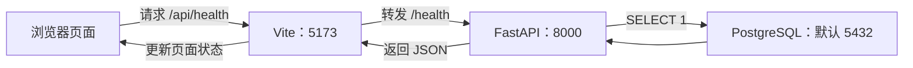

# Issue 04：项目骨架与基础服务

## 分支与范围

本次工作在 `feat/project_skeleton` 分支完成，不直接修改 `main`，也不创建或合并 GitHub PR。
后端、前端和 Rust 工程分别独立启动；数据库表仍由已有 Alembic 迁移创建，应用启动和健康检查不执行建表 DDL。

股票数据范围继续使用 `config/stock_pool.csv` 中固定的 20 只 A 股，本 Issue 不爬取全市场。

## 安装与数据库前置

Python 依赖由 `uv` 管理，首次同步：

```bash
uv sync
```

首次使用且根目录没有 `.env` 时，先复制配置模板；已有本机 `.env` 不要覆盖：

```bash
cp .env.example .env
```

先启动 PostgreSQL 并执行已有迁移：

```bash
docker compose up -d --wait
uv run alembic upgrade head
```

数据库配置从项目根目录 `.env` 读取，优先使用终端环境变量和 `DATABASE_URL`。

## 启动服务

后端：

```bash
uv run uvicorn app.main:app --reload --port 8000
```

健康接口为 `GET http://localhost:8000/health`。每次请求执行 `SELECT 1`：数据库可达返回 200 和
`{"status":"ok","database":"up"}`；数据库不可达返回 503 和固定提示 `数据库不可用`，原始异常只写入日志。

前端：

```bash
cd frontend
npm install
npm run dev
```

前端开发服务器监听 `http://localhost:5173`，通过 Vite `/api` 代理访问后端，首屏显示服务状态、数据库状态和 API 地址。

Rust CLI：

```bash
cd rust
cargo run
```

CLI 输出 `{"status":"ok","service":"rust-cli"}`，本 Issue 不接数据库、不提供 HTTP 端口、不实现指标计算。

## 验证

```bash
uv run pytest -q
cd frontend && npm run build
cd ../rust && cargo fmt --check && cargo test && cargo run
```

数据库断开时停止 PostgreSQL，再请求 `/health`，应得到 HTTP 503；恢复数据库后应回到 HTTP 200。

## 框架结构

本次添加三套工程入口：前端负责显示页面，Python 后端负责接口和数据库连接，Rust 先作为独立命令运行。后端继续复用 Issue 03 的数据库配置、模型和导入代码。

```text
Market_Bashboard/
├── app/
│   ├── main.py                 新增：FastAPI 入口、健康接口
│   ├── db.py                   复用：数据库配置和连接引擎
│   ├── models.py               复用：股票与行情表模型
│   └── ...                     复用：行情获取、规范化和导入
│
├── frontend/                   新增：前端工程
│   ├── index.html              页面入口
│   ├── package.json            前端依赖和启动命令
│   ├── package-lock.json       锁定依赖版本
│   ├── vite.config.ts          开发端口和接口代理
│   ├── tsconfig*.json          TypeScript 检查配置
│   └── src/
│       ├── main.tsx            把 React 页面挂到 HTML 上
│       ├── App.tsx             状态页面和健康接口请求
│       └── styles.css          页面样式
│
├── rust/                       新增：Rust 命令行工程
│   ├── Cargo.toml              工程名称、版本、入口配置
│   ├── Cargo.lock              锁定依赖版本
│   └── src/main.rs             命令入口和单元测试
│
├── tests/test_health.py         新增：健康接口测试
├── plan/learning/04.md          新增：启动和验证记录
├── pyproject.toml              补充 Python 依赖
└── uv.lock                     更新 Python 依赖锁文件
```

### 后端：`app/main.py`

`app/main.py` 创建 FastAPI 应用，并注册 `/health` 接口。启动命令中的 `app.main:app` 表示加载 `app/main.py` 中名叫 `app` 的应用。

FastAPI 负责定义接口和响应，Uvicorn 负责监听端口、接收 HTTP 请求。`--reload` 用于开发时修改后端代码后自动重启服务。

`lifespan` 管理应用启动和退出：启动时通过已有 `app/db.py` 创建数据库连接引擎，存放在 `app.state.engine` 中；退出时释放连接池。创建引擎不会立即检查数据库可达性，健康请求会获取连接并执行 `SELECT 1`。

`SELECT 1` 只验证数据库能否执行 SQL，不查询股票或行情，也不创建表。表结构继续由 `alembic/` 中的迁移管理。缺少数据库配置时，应用启动会给出明确错误；数据库连接失败时，健康接口返回 503。

### 前端：`frontend/`

| 工具 | 在项目中的作用 |
| --- | --- |
| React | 用组件构建页面，状态变化后更新显示 |
| TypeScript | 检查代码类型，例如健康响应有哪些字段 |
| Vite | 启动开发服务器，并把源码构建成浏览器可用的文件 |

页面启动顺序：

```text
index.html → src/main.tsx → App.tsx
```

`index.html` 提供 `root` 容器；`main.tsx` 把 React 的 `App` 组件挂到容器上；`App.tsx` 请求健康接口、保存请求状态，再显示“检查中”、检查结果或连接错误。“重新检查”按钮会再次请求接口。`styles.css` 负责页面样式。

`vite.config.ts` 配置开发端口和接口代理：收到 `/api/health` 后，去掉 `/api` 前缀，转发给后端的 `/health`。

### 为什么前端和后端用不同端口

前端 Vite 和后端 FastAPI 是两个独立运行的程序，需要各自监听一个端口。同一个地址上的同一个端口通常只能由一个程序监听，开发阶段分开便于启动和排错。

- `5173`：Vite 提供页面，并在修改前端代码时自动更新。
- `8000`：Uvicorn 接收后端接口请求，由 FastAPI 处理。
- `5432`：本地 PostgreSQL 的默认端口，实际以 `.env` 的 `DB_PORT` 为准。

浏览器只需打开 `http://localhost:5173`。页面请求 `/api/health` 时，Vite 自动转发给后端，再把结果交回页面。以后部署可以使用一个统一入口提供页面和接口。

### 健康检查的请求流程



### Rust：`rust/`

`Cargo.toml` 定义工程名称、版本和命令入口；`src/main.rs` 是独立的终端程序入口。执行 `cargo run` 后输出：

```json
{"status":"ok","service":"rust-cli"}
```

Rust 目前没有接入上面的请求流程，也没有 HTTP 端口。这一步验证 Rust 工程可以独立编译和运行；Issue 05 再添加指标计算，并与 Python 连接。

### 测试、配置和构建产物

`tests/test_health.py` 用假数据库引擎检查成功响应、连接失败响应和缺配置时的启动错误，单元测试无需真实数据库。真实 PostgreSQL 的连接、断开和恢复另外通过手工联调验证。

`pyproject.toml` 和 `package.json` 声明依赖及命令；`uv.lock`、`package-lock.json` 和 `Cargo.lock` 记录实际依赖版本。根目录 `.env` 保存本机数据库配置，沿用 Issue 03 的读取方式，不提交到 Git。

运行后生成的目录：

| 目录 | 内容 | Git 是否忽略 |
| --- | --- | --- |
| `frontend/node_modules/` | 安装的前端依赖 | 是 |
| `frontend/dist/` | 前端构建结果 | 是 |
| `rust/target/` | Rust 编译结果和缓存 | 是 |
